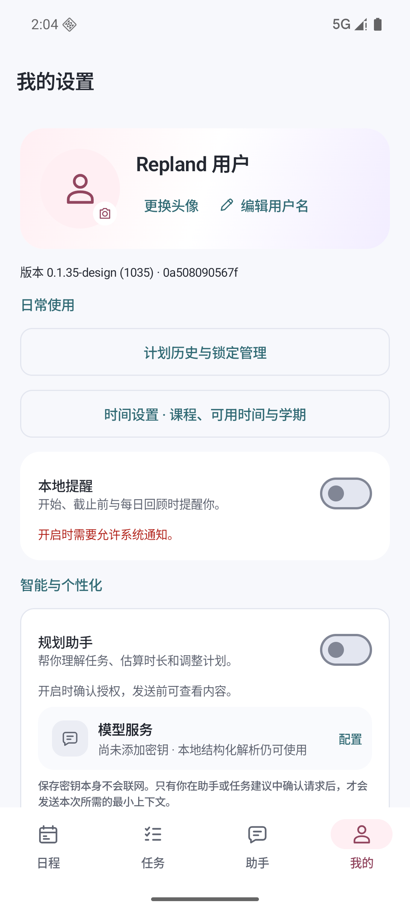

# Repland 设计副本 · 2026-10-15

这是用户确认的最新前端版本：柔和多色、运行时点击反馈、“总计 / 详细”日程，以及可更换的头像和可编辑用户名。独立安装包名为 `com.swan1127.repland.design`，不会覆盖原版 `.current`。

## 预览



[编辑用户名](edit-name.png) · [总计](summary.png) · [详细](details.png) · [29 秒原生动态演示](schedule-demo.mp4)

日程截图和视频明确使用只读演示数据，不是实际用户计划；个人资料截图为默认姓名和默认头像。

## 构建

需要 JDK 17、Android SDK 36，并配置 `ANDROID_HOME` 或 `android/local.properties` 中的 SDK 路径。也可用 Android Studio 打开 `android/` 并选择 `designPreview` 构建变体。

Windows PowerShell：

```powershell
.\android\gradlew.bat -p .\android :app:assembleDesignPreview :app:testDesignPreviewUnitTest :app:verifyOfflineMvpBoundary
```

APK 生成于 `android/app/build/outputs/apk/designPreview/app-designPreview.apk`。构建产物、SDK、模拟器、缓存、个人资料与凭据不进入 Git。根目录的 `Start-Design.ps1` / `Build-Design.ps1` 是当前交付电脑的便捷入口，依赖其相邻 `Environment`；其他电脑按上面的标准 Gradle 方式构建。

仓库 CI 保留默认 `debug` 仪器测试。构建设计版的隔离设备测试包时添加 `-PreplandTestBuildType=designPreview` 并执行 `:app:assembleDesignPreviewAndroidTest`；安装后使用 `com.swan1127.repland.design.test/androidx.test.runner.AndroidJUnitRunner`。

## 本轮验证

- 163 项单元测试、33 个套件，0 失败。
- 37 项专项设备测试通过：5 项个人资料存储、5 项个人资料交互、8 项优先级日程、9 项既有日程入口、4 项动效、6 项任务录入回归。[设备测试结果（仅规范化换行）](device-tests.txt)
- 默认 debug 仪器测试任务图 dry-run 通过；API 26 完整 CI 尚待 GitHub 执行。
- 实际照片选择器选图、头像重启保留与恢复默认已验证；窄屏、横屏、平板、200% 字体、暗色、减少动画和键盘弹出场景已检查。
- 未运行整套历史仪器测试、完整 TalkBack、真机矩阵或真实模型调用，本轮结果不扩大为这些项目的验收。

验证的本机安装包 SHA-256：`e4ee1fe8e2c025811401575fe77d6d4d6d7fff69faec550d72778763af917947`。该 APK 构建于提交之前，内部 `BUILD_SOURCE` 为基底 `0a508090567f`；新检出构建会写入新的提交号，因此不承诺 APK 字节相同。源码与测试结果见[验证摘要](verification.json)。

[源码 SHA-256 清单](source-sha256.json) 按 Git 暂存区归一化后的 blob 字节计算；操作系统检出时转换 CRLF/LF 会改变磁盘文件的字节哈希。

实现与边界：[个人资料](../../DESIGN_PERSONAL_PROFILE.md)、[日程与配色](../../DESIGN_PRIORITY_SCHEDULE.md)、[当前交付说明](../../DESIGN_CURRENT.md)。其他历史设计文档中的 `../../work/` 链接仅在原交付电脑可用，本目录提供可随仓库查看的当前证据。
